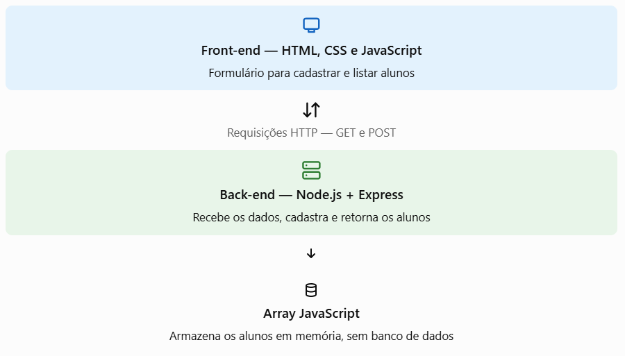

# FullStack

## 1. Como será a comunicação?


- Nesse primeiro momento não vamos usar banco de dados, rotas separadas ou controllers. Tudo ficará simples para entender como o front-end conversa com o back-end.

**Lembrando que:** Todo projeto é de extrema importância o MVC organizado com seus controladores e rotas.

## 2. Esturutra do projeto

```
cadastro-alunos/
│
├── backend/
│   ├── server.js
│   └── package.json
│
└── frontend/
    ├── index.html
    ├── style.css
    └── script.js
```

## 3. Criando um backEnd
Abra o terminal em prompt de comandos e digite:

```
npm init -y
npm install express cors
```

- **Express:** facilita a criação do servidor e das rotas.
- **CORS:** permite que o front-end, executado em outra porta, faça requisições ao servidor.

Vamos criar o arquivo server.js juntos:

```javascript
    console.log("Despois vou subir os códigos aqui. =D")
```

**Entendendo o Código:**

| Código | Função |
| --- | --- |
| `require("express")` | Importa o Express. |
| `express()` | Cria a aplicação do servidor. |
| `app.use(cors())` | Permite a comunicação entre origens diferentes. |
| `express.json()` | Permite interpretar os dados recebidos em JSON. |
| `app.get("/alunos")` | Cria uma rota para consultar alunos. |
| `app.post("/alunos")` | Cria uma rota para cadastrar alunos. |
| `req.body` | Acessa os dados enviados pelo front-end. |
| `alunos.push()` | Adiciona um aluno ao array. |
| `res.json()` | Retorna dados ao front-end no formato JSON. |
| `app.listen()` | Inicia o servidor. |

## 4. Criando o Front-End

Aqui vai ficar o visual da página, um formulário e a lista de alunos.

O arquivo **index.html**: Nossa estrutura da página.

```html
    <p>Depois vou colocar os códigos aqui também =D </p>
```

Agora o **CSS**: Vamos melhorar a aparência...

```css
    Já sabe né?
```

E por último todas as ligações entre as partes. Ligações do nosso front-end com o back-end. Observe principalmente o uso do fetch().

**script.js**:
```javascript
    console.log("Já falei que só depois vou colocar os códigos aqui... ESPERAAAA")
```

## 5. Como funciona essa comunicação?

1. O usuário preenche o formulário
O HTML coleta o nome e o curso digitados.

2. O JavaScript envia os dados
O fetch() faz uma requisição POST para http://localhost:3000/alunos, enviando os dados em JSON.

3. O Express recebe a requisição
O back-end lê o req.body, cria o objeto do aluno e adiciona esse objeto ao array.

4. O front-end atualiza a lista
O servidor retorna uma resposta. O JavaScript consulta novamente a rota GET e exibe os alunos na tela.

### O que significa fetch()?
O fetch() é uma função do JavaScript usada para fazer requisições HTTP. Ela permite que o front-end solicite informações ou envie dados para um servidor.

**Exemplo de consulta:**
```javascript
    const resposta = await fetch("http://localhost:3000/alunos");
    const dados = await resposta.json();
```

- fetch(url): faz uma requisição GET por padrão.
- await: aguarda a conclusão de uma operação assíncrona.
- resposta: contém a resposta HTTP recebida do servidor.
- resposta.json(): lê o conteúdo JSON da resposta.

Para cadastrar, utilizamos o mesmo **fetch()**, mas informamos method: **"POST"** e enviamos os dados no body.

## 6. Como executar o projeto
1. Abra o terminal dentro da pasta backend.
2. Execute node server.js.
3. Confira se apareceu a mensagem Servidor funcionando na porta 3000.
4. Abra a pasta frontend no VS Code e execute o index.html com a extensão Live Server.
5. Cadastre novos alunos e veja a lista sendo atualizada automaticamente.

---

## Desafio
Depois de executar o exemplo, proponha estas modificações:
- Adicionar o campo de e-mail ao formulário.
- Criar uma rota GET para consultar a quantidade de alunos cadastrados.
- Impedir o cadastro quando o nome tiver menos de três caracteres.
- Exibir o ID de cada aluno na lista.