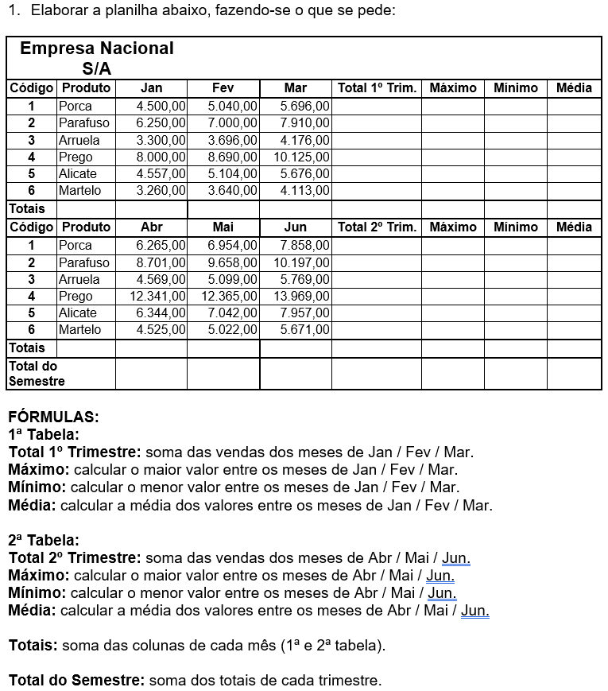

#  operações básicas:
```
    =SOMA() -> Faz uma soma dos valores
    =MÉDIA() -> Faz uma média aritmética
    =MULT() -> Multiplica os valores
    =MÁXIMO() -> Pega o maior valor
    =MÍNIMO() -> Pega o menor valor
```

## Atividade 01




# Atividade 01 — Planilha de Vendas

## Empresa Nacional S/A

### 1ª Tabela — 1º Trimestre

| Código | Produto | Jan | Fev | Mar | Total 1º Trim. | Máximo | Mínimo | Média |
|:---:|---|---:|---:|---:|---:|---:|---:|---:|
| 1 | Porca | 4.500,00 | 5.040,00 | 5.696,00 | | | | |
| 2 | Parafuso | 6.250,00 | 7.000,00 | 7.910,00 | | | | |
| 3 | Arruela | 3.300,00 | 3.696,00 | 4.176,00 | | | | |
| 4 | Prego | 8.000,00 | 8.690,00 | 10.125,00 | | | | |
| 5 | Alicate | 4.557,00 | 4.510,00 | 5.676,00 | | | | |
| 6 | Martelo | 3.260,00 | 3.640,00 | 4.113,00 | | | | |
| **Totais** | | | | | | | | |

### 2ª Tabela — 2º Trimestre

| Código | Produto | Abr | Mai | Jun | Total 2º Trim. | Máximo | Mínimo | Média |
|:---:|---|---:|---:|---:|---:|---:|---:|---:|
| 1 | Porca | 6.265,00 | 6.954,00 | 7.858,00 | | | | |
| 2 | Parafuso | 8.701,00 | 9.658,00 | 10.197,00 | | | | |
| 3 | Arruela | 4.569,00 | 5.099,00 | 5.769,00 | | | | |
| 4 | Prego | 12.341,00 | 12.365,00 | 13.969,00 | | | | |
| 5 | Alicate | 6.344,00 | 7.042,00 | 7.957,00 | | | | |
| 6 | Martelo | 4.525,00 | 5.022,00 | 5.671,00 | | | | |
| **Totais** | | | | | | | | |
| **Total do Semestre** | | | | | | | | |

---

## Fórmulas e instruções

### 1ª Tabela

- **Total 1º Trimestre:** somar as vendas dos meses de janeiro, fevereiro e março.
- **Máximo:** calcular o maior valor entre janeiro, fevereiro e março.
- **Mínimo:** calcular o menor valor entre janeiro, fevereiro e março.
- **Média:** calcular a média dos valores de janeiro, fevereiro e março.

### 2ª Tabela

- **Total 2º Trimestre:** somar as vendas dos meses de abril, maio e junho.
- **Máximo:** calcular o maior valor entre abril, maio e junho.
- **Mínimo:** calcular o menor valor entre abril, maio e junho.
- **Média:** calcular a média dos valores de abril, maio e junho.

### Totais

- **Totais:** somar os valores de cada coluna mensal, considerando os produtos de cada tabela.
- **Total do Semestre:** somar os totais de cada trimestre.
